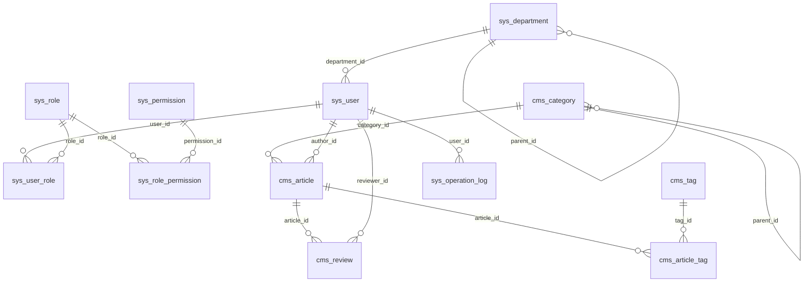

# EnterpriseCMS 数据库说明（MySQL 8.4）

本目录包含 EnterpriseCMS 的建表脚本与基线种子脚本。应用默认配置 `spring.sql.init.mode=never`，不会在启动时自动导入 SQL，所有脚本均由开发者显式执行。

---

## 一、脚本清单与执行顺序

所有正式初始化脚本均统一指向 `enterprise_cms` 库并按编号从小到大连续执行，在 Navicat 中直接依次运行即可。

| 序号 | 文件 | 类型 | 幂等性 | 说明 |
| --- | --- | --- | --- | --- |
| 1 | `001_init.sql` | 建表 DDL | 可重复（`IF NOT EXISTS`） | 一步建齐 12 张核心表（含 `sys_user.status_version` 与全部高频查询复合索引） |
| 2 | `002_seed_permission_baseline.sql` | 权限基线种子（B） | 可重复（缺则补） | 初始化 4 个角色、53 个 API 权限项及 95 条默认角色权限关联 |
| 3 | `003_seed_user_baseline.sql` | 用户组织种子（A） | 可重复（指纹保护） | 初始化 2 个演示部门与 4 个本地测试账号（仅限本地/课程开发环境） |
| 4 | `004_seed_review_log_demo.sql` | 演示种子（D，可选） | 可重复（固定 ID 守卫） | 初始化课程演示分类 1、标签 2、文章 5、审核历史 2、标签关联 2 |
| 5 | `005_portal_cache_revision.sql` | 门户缓存迁移（启用缓存时必需） | 可重复（重跑更新缓存版本） | 创建门户文章详情与分类树的缓存版本表 |

> **重要注意事项**：
> - `001_init.sql` 不包含 `DROP DATABASE`，以兼容后端 3 个真实 MySQL 集成测试（`ReviewQueryServiceMysqlIT`、`PendingReviewServiceMysqlIT`、`ArticleTagServiceMysqlIT`）。
> - `001`～`005` 均统一包含 `USE enterprise_cms;`；如需导入到隔离测试库（如 `enterprise_cms_bench`），请在导入副本中替换所有 `USE` 的目标库名，以及 `001` 的 `CREATE DATABASE` 目标库名。
> - `004_seed_review_log_demo.sql` 使用固定大主键（`990101`、`990301`–`990305`、`990601`–`990602`），导入后对应表的 `AUTO_INCREMENT` 会顺延至 `990xxx` 起步，属预期行为。
> - `003` 与 `004` 仅限本地/课程开发环境，禁止用于生产或公网可达环境。

### 重建开发库时切换 Redis 会话库

1. 停止连接该开发库的所有后端实例。确认 MySQL 目标实例和库名后，手工清空专用开发库，按上表顺序导入。单独重跑 `001` 会保留已有表。
2. 在同一 Redis 实例上选一个空闲、专供这套开发环境使用的逻辑库。例如团队分配了 1 号库，可对后端实际连接的 Redis 执行 `redis-cli -n 1 DBSIZE`，预期返回 `0`。远程或启用认证的实例使用对应的连接参数。
3. 在所有共用该 MySQL 库的后端运行配置中设置 `SPRING_DATA_REDIS_DATABASE=1`（换成实际分配的编号），保存配置并重新启动。旧库中按用户 ID 保存的会话和撤销版本属于上一次初始化。
4. 在 Apifox 用重建前仍有效的 Token 请求 `GET /api/auth/me`，预期为 401。用 `003` 中的测试账号重新登录，用新 Token 请求同一接口，预期为 200。

---

## 二、E-R 关系图（12 张核心表）

---

## 三、12 张核心表与关键索引说明

| 归属 | 表名 | 主键 / 唯一约束 | 关键索引（均已内置于 `001_init.sql`） |
| --- | --- | --- | --- |
| A | `sys_department` | `PK(id)`、`UK(dept_code)` | `idx_department_parent(parent_id)` |
| A | `sys_user` | `PK(id)`、`UK(username)` | `idx_user_department(department_id)`、`idx_user_updated(updated_at, id)` |
| A | `sys_user_role` | `PK(user_id, role_id)` | `idx_user_role_role(role_id)` |
| B | `sys_role` | `PK(id)`、`UK(role_code)` | 按唯一编码与主键索引检索 |
| B | `sys_permission` | `PK(id)`、`UK(permission_code)` | `idx_permission_type_status(permission_type, status, updated_at, id)` |
| B | `sys_role_permission` | `PK(role_id, permission_id)` | `idx_role_permission_permission(permission_id)` |
| C | `cms_category` | `PK(id)` | `idx_category_parent(parent_id)` |
| C | `cms_tag` | `PK(id)`、`UK(tag_name)` | 按唯一名称与主键索引检索 |
| C | `cms_article` | `PK(id)` | `idx_article_status_published(is_deleted, status, published_at)`、`idx_article_deleted_status_updated(is_deleted, status, updated_at, id)`、`idx_article_deleted_updated(is_deleted, updated_at, id)`、`idx_article_author_deleted_updated(author_id, is_deleted, updated_at, id)`、`idx_article_category(category_id)`、`idx_article_author(author_id)` |
| D | `cms_review` | `PK(id)` | `idx_review_article_time(article_id, reviewed_at)`、`idx_review_reviewer(reviewer_id)` |
| D | `cms_article_tag` | `PK(article_id, tag_id)` | `idx_article_tag_tag(tag_id)` |
| D | `sys_operation_log` | `PK(id)` | `idx_operation_log_user_time(user_id, created_at)`、`idx_operation_log_time(created_at)`、`idx_operation_log_op_time(operation, created_at, id)`、`idx_operation_log_result_time(result, created_at, id)` |

---

## 四、设计约定与边界说明

1. **字符集与时区**：全库统一 `utf8mb4` / `utf8mb4_0900_ai_ci`；业务时间字段统一 `DATETIME(3)`（本地 `Asia/Shanghai` 时间，不带时区偏移）。
2. **数据一致性与删除安全**：
   - `cms_article` 采用逻辑删除（`is_deleted`）+ 乐观锁（`version`）；
   - `cms_category` 删除前受 `fk_article_category` 保护，存在子分类或任意文章引用（含逻辑删除文章）均返回 `409`；
   - `sys_user` 仅支持启停，保留历史文章、审核记录与审计日志。
3. **数值上界说明**：
   - 表主键采用 `BIGINT UNSIGNED`、`cms_article.version` 采用 `INT UNSIGNED`；Java/OpenAPI 契约按有符号 `Long.MAX_VALUE`（`9223372036854775807`）与 `Integer.MAX_VALUE`（`2147483647`）校验上界，并由后端服务层拦截溢出。

---

## 五、阶段 5 索引优化对比与压测造数指南

仓库在 [tests/benchmark_seed.sql](../tests/benchmark_seed.sql) 提供了独立的大样本造数脚本（生成 5 个压测分类、10 个压测标签、2,000 篇压测文章、约 4,000 条标签关联与 20,000 条操作日志），**严禁在生产库运行**。

建议按以下顺序在专用测试库完成 `EXPLAIN` 优化前后对比：
1. 新建专用压测库（如 `enterprise_cms_bench`），导入 `001_init.sql`、`002`、`003`（按第一节替换建库和选库语句的目标库名）；
2. 导入 `tests/benchmark_seed.sql`，直接运行该脚本末尾的 4 条 `EXPLAIN` 查询记录**优化后**执行计划；
3. 如需记录**优化前**基线，可在查询中使用 `IGNORE INDEX (...)`（或临时删除对应复合索引后再建回）执行同一条 `EXPLAIN`，保存前后 `type`、`key`、`rows` 与 `Extra`（重点对比 `Using filesort`）的差异。
